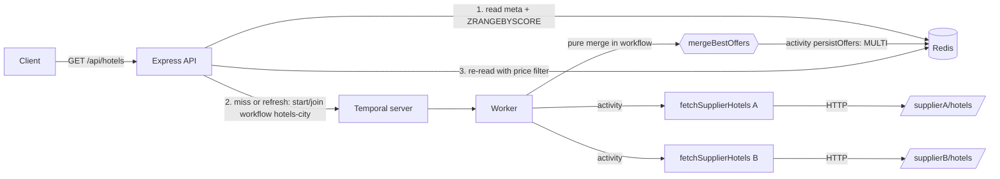
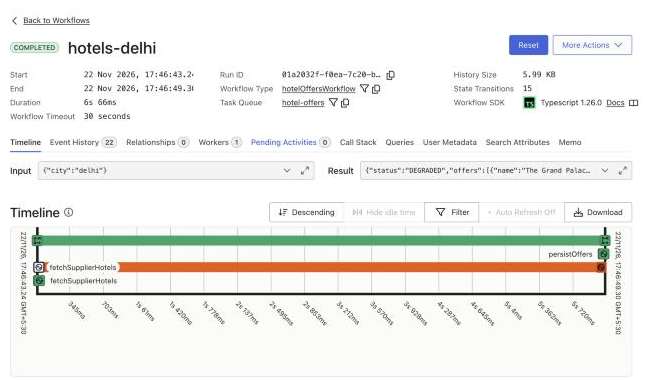

# Hotel Offer Orchestrator

Aggregates hotel offers from two suppliers, de-duplicates hotels by name, keeps the best offer per
hotel and serves price-filtered results from Redis. A Temporal workflow does the supplier fan-out.

[](https://github.com/alirizzzv/Tripare-AI/actions/workflows/ci.yml)

**Stack:** Node.js 22 + TypeScript (strict), Express 5, Temporal (TypeScript SDK), Redis 7, Docker Compose, Caddy.
**Live URL:** TODO (see [docs/DEPLOYMENT.md](docs/DEPLOYMENT.md))

---

## Quickstart

Needs Docker with Compose v2. No `.env` file is required.

```bash
git clone https://github.com/alirizzzv/Tripare-AI.git && cd Tripare-AI
docker compose up --build -d
./scripts/wait-healthy.sh        # waits until /health is "ok" (worker polling included)
```

- API: <http://localhost:3000>
- Temporal Web UI: <http://localhost:8233> (open the `hotels-delhi` workflow after the first request)

```bash
curl -s "localhost:3000/api/hotels?city=delhi" | jq                          # deduped best offers
curl -s "localhost:3000/api/hotels?city=delhi&minPrice=5000&maxPrice=6000" | jq  # filtered in Redis
curl -s "localhost:3000/api/hotels?city=jaipur"                              # []  (valid city, no hotels)
curl -s "localhost:3000/health" | jq                                         # suppliers, Redis, Temporal, worker
```

Expected for Delhi (excerpt):

```json
[
  { "name": "The Grand Palace", "price": 4500, "supplier": "Supplier A", "commissionPct": 11 },
  { "name": "Holtin",           "price": 5340, "supplier": "Supplier B", "commissionPct": 20 },
  { "name": "Radison",          "price": 5900, "supplier": "Supplier A", "commissionPct": 13 }
]
```

Run `./scripts/smoke.sh` for a quick automated check, or `npm run test:postman` for the full Postman suite.
Stop with `docker compose down` (`docker compose down -v` also wipes the Temporal history).

---

## What it does

1. `GET /api/hotels?city=delhi` checks Redis first.
2. On a miss (or `refresh=true`) it starts a Temporal workflow that calls **Supplier A and Supplier B in parallel**.
3. The workflow de-duplicates hotels by normalized name and keeps the best offer:
   **lower price wins → if equal, higher `commissionPct` wins → if still equal, Supplier A.**
   A hotel that only one supplier has is kept as is.
4. The de-duplicated list is saved to Redis (sorted set, score = price) in one atomic `MULTI`.
5. The API reads the result **from Redis**, and `minPrice` / `maxPrice` are applied **inside Redis**
   with `ZRANGEBYSCORE` (inclusive bounds). Results are sorted by price ascending.

### Endpoints

| Method | Path | Params | Success | Errors | Headers |
|---|---|---|---|---|---|
| GET | `/api/hotels` | `city` (required, 1–60 chars: letters, spaces, `.` `-`), `minPrice`, `maxPrice` (numbers ≥ 0, inclusive), `refresh=true\|false` | `200` bare array of `{name, price, supplier, commissionPct}`; `[]` for a valid city with no hotels | `400` invalid input · `503` both suppliers down / Redis down / Temporal down · `504` workflow slower than `WORKFLOW_WAIT_MS` | `X-Cache: HIT\|MISS\|REFRESH`; when degraded: `X-Degraded: true`, `X-Failed-Suppliers: supplierB`; `Retry-After: 10` on 503 SUPPLIERS_UNAVAILABLE; `X-Request-Id` always |
| GET | `/supplierA/hotels`, `/supplierB/hotels` | `city` (optional, case-insensitive) | `200` raw supplier records `{hotelId, name, price, city, commissionPct}` | `503` when chaos sets the supplier down | |
| GET | `/health` | | `200` `ok` or `degraded` (exactly one supplier down) | `503` `down` | |
| GET | `/ping` | | `200 {"ok":true}` (liveness for Docker) | | |
| GET/POST | `/__chaos`, `/__chaos/:supplier`, `/__chaos/reset` | body `{"mode":"ok"\|"down"\|"slow","delayMs":0-10000}` | `200` current modes | `400`, `401` without `x-chaos-token` (when `CHAOS_TOKEN` is set) | only mounted when `ENABLE_CHAOS=true` |

Every error uses one shape: `{"error":{"code","message","details?"}}`.

| Situation | HTTP | `error.code` |
|---|---|---|
| bad/missing city, bad prices, min > max, bad `refresh`, repeated/array params, bad chaos body, malformed JSON | 400 | `VALIDATION_ERROR` |
| unknown route | 404 | `NOT_FOUND` |
| missing/wrong `x-chaos-token` | 401 | `UNAUTHORIZED` |
| body > 10 kb | 413 | `PAYLOAD_TOO_LARGE` |
| both suppliers failed | 503 | `SUPPLIERS_UNAVAILABLE` (+ `Retry-After: 10`) |
| Redis unreachable | 503 | `CACHE_UNAVAILABLE` |
| Temporal unreachable | 503 | `ORCHESTRATOR_UNAVAILABLE` |
| workflow failed for another reason (e.g. persist exhausted retries) | 503 | `WORKFLOW_FAILED` |
| workflow still running after `WORKFLOW_WAIT_MS` (it keeps running) | 504 | `WORKFLOW_TIMEOUT` |
| anything else | 500 | `INTERNAL_ERROR` (details only in logs) |

5xx responses never include internal error text; the full error is logged with the request id.

---

## Architecture



The mock suppliers live inside the API service (as the assignment asks), so the worker reaches them
over HTTP at `http://api:3000/supplierA` just like a real external supplier.

**Request flow**

1. Validate the query with Zod; normalize the city (`"  DeLHi "` → `delhi`).
2. Unless `refresh=true`, read Redis in one `MULTI` (meta hash + `ZRANGEBYSCORE`). Hit → `200`, `X-Cache: HIT`.
3. Miss → start workflow `hotels-delhi` with `workflowIdConflictPolicy: USE_EXISTING`, so concurrent
   cold requests for the same city **join one run** instead of starting many.
4. Workflow: `Promise.allSettled` over the two `fetchSupplierHotels` activities → `mergeBestOffers` (pure) → `persistOffers` activity.
5. API waits up to `WORKFLOW_WAIT_MS` (8 s), then re-reads Redis **with the price filter** (one read path for every request) and responds.

### Failure behaviour

| Scenario | HTTP | Headers | Cache |
|---|---|---|---|
| Both suppliers OK | 200 | `X-Cache: MISS` (then `HIT`) | full list, TTL 600 s |
| One supplier down | 200 (other supplier's offers) | `X-Degraded: true`, `X-Failed-Suppliers: supplierB` | degraded list, TTL **60 s** (also flagged on later HITs) |
| Both suppliers down | 503 `SUPPLIERS_UNAVAILABLE` | `Retry-After: 10` | **nothing written**; never turned into `[]` |
| Valid city, no hotels | 200 `[]` | `X-Cache` | empty list cached (meta hash marks "cached but empty") |
| Invalid input | 400 `VALIDATION_ERROR` | | not touched |
| Redis down | 503 `CACHE_UNAVAILABLE` | | n/a |
| Workflow slower than 8 s | 504 `WORKFLOW_TIMEOUT` | | the run continues and fills the cache for the next request |
| Worker down | 504 after 8 s (the workflow waits in the task queue); `/health` reports `down` (no pollers) | | filled once a worker comes back |

Every outage can be reproduced with the chaos switch, e.g.
`curl -X POST localhost:3000/__chaos/supplierB -H 'content-type: application/json' -d '{"mode":"down","delayMs":0}'`
(auto-reverts after 60 s; `POST /__chaos/reset` resets both).

---

## Redis data model

| Key | Type | Content | TTL |
|---|---|---|---|
| `hotels:{city}:offers` | sorted set | member = JSON offer `{"name","price","supplier","commissionPct"}`, score = price | 600 s (60 s if degraded) |
| `hotels:{city}:meta` | hash | `degraded`, `failedSuppliers`, `fetchedAt` | same as offers |

- **Why a sorted set:** a price range is exactly `ZRANGEBYSCORE key min max` (O(log N + M)), already sorted,
  so filtering happens in Redis, not in Node. Missing bounds become `-inf` / `+inf`.
- **Why a meta hash:** it is always written, so "cached but empty" (`[]`) is different from "never fetched";
  and it carries the degraded flag so a cache HIT can still return `X-Degraded`.
- **Atomic write:** one `MULTI`: `DEL` both keys → `ZADD` → `HSET` meta → `EXPIRE` both. A reader never sees
  a half-written list. Reads are also one `MULTI` (meta + range) so they are consistent with each other.
- Equal prices are ordered by member bytes in Redis; `mergeBestOffers` uses the same `serializeOffer` comparator so the workflow result and Redis agree.
- `{city}` is always `normalizeCity()` output and validated at the API edge, so user input never reaches a key raw.

## Temporal design

- **Workflow** `hotelOffersWorkflow({city})` is deterministic: no I/O, no clock, no randomness. It imports only
  `@temporalio/workflow` and pure files from `src/domain`. All HTTP and Redis work is in **activities**.
- **Activities:** `fetchSupplierHotels` (HTTP with a 2.5 s `AbortController` timeout, Zod-validates each record,
  skips bad ones and logs `invalidCount`) and `persistOffers` (idempotent: DEL + ZADD gives the same state when retried).
- **Timeouts and retries:** `startToCloseTimeout` 3 s, `scheduleToCloseTimeout` 6 s,
  retry `maximumAttempts: 3`, backoff 200 ms × 2 (max 1 s).
  - A **fast failure** (e.g. HTTP 503) gets all 3 attempts within about a second.
  - A **slow supplier** gets **two attempts, not three**: attempt 1 is aborted at 2.5 s, attempt 2 runs
    ~2.7–5.2 s, and then there is no time left for a third attempt before the 6 s `scheduleToCloseTimeout`.
    **Measured** with chaos `slow 5000` on Supplier B (screenshot below): the workflow finished DEGRADED in
    **6.07 s** and the event history shows `ACTIVITY_TASK_TIMED_OUT` with Temporal's message
    *"Not enough time to schedule next retry before activity ScheduleToClose timeout, giving up retrying"*
    (cause: `Supplier supplierB request timed out after 2500ms`). That stays under the API's 8 s wait.
  - **Non-retryable:** HTTP 4xx (except 408/429), invalid JSON, non-array payloads → `ApplicationFailure.nonRetryable`.
- **Workflow ID** `hotels-{encodeURIComponent(city)}` + `USE_EXISTING`: concurrent requests share one run
  (covered by an integration test against a real local Temporal server: 20 concurrent starts for one city
  return identical results and each supplier activity runs exactly once).
  After a run completes, the next miss correctly starts a new run.
- The API never terminates a slow workflow: it returns 504 and the run still fills the cache.



*Temporal Web UI, `hotels-delhi` with Supplier B set to slow (5 s): the two `fetchSupplierHotels` activities start
in parallel, A completes in milliseconds, B (orange) times out at 6 s, then `persistOffers` saves the degraded list.*

## Configuration

All config comes from environment variables, validated with Zod at start-up (the process exits with a clear message if invalid).
Defaults suit `npm run dev:*`; `docker-compose.yml` sets the in-container values.

| Variable | Default | Purpose |
|---|---|---|
| `PORT` | `3000` | API port |
| `REDIS_URL` | `redis://localhost:6379` | Redis connection |
| `TEMPORAL_ADDRESS` | `localhost:7233` | Temporal frontend |
| `TEMPORAL_NAMESPACE` | `default` | Temporal namespace |
| `TEMPORAL_TASK_QUEUE` | `hotel-offers` | task queue shared by API and worker |
| `SUPPLIER_A_URL` / `SUPPLIER_B_URL` | `http://localhost:3000/supplierA` / `…/supplierB` | supplier base URLs (`http://api:3000/...` in Compose) |
| `SUPPLIER_TIMEOUT_MS` | `2500` | per-call HTTP timeout (kept below the 3 s activity timeout) |
| `CACHE_TTL_SECONDS` | `600` | TTL for a full result |
| `DEGRADED_TTL_SECONDS` | `60` | TTL when one supplier failed |
| `WORKFLOW_WAIT_MS` | `8000` | how long the API waits before 504 |
| `ENABLE_CHAOS` | `false` (`true` in Compose) | mount `/__chaos` routes |
| `CHAOS_TOKEN` | empty | if set, chaos routes need `x-chaos-token` (required in prod) |
| `CHAOS_TTL_SECONDS` | `60` | chaos modes auto-revert after this |
| `LOG_LEVEL` | `info` | pino level |
| `DOMAIN` | | prod only: hostname for Caddy/HTTPS |

## Testing

| Layer | Command | Needs |
|---|---|---|
| Lint + types | `npm run lint && npm run typecheck` | `npm ci` (Node 22, see `.nvmrc`) |
| Unit (domain, API with mocks, activities with mocked fetch, chaos, health) | `npm test` | nothing; enforces ≥ 90 % coverage on `src/domain` |
| Integration (Redis repo, Temporal workflow incl. retries/non-retryable, 20 concurrent starts) | `npm run test:integration` | `docker compose up -d redis`; Temporal test server downloads on first run |
| End-to-end (Postman via newman) | `npm run test:postman` | the Compose stack running |
| Smoke (any URL) | `./scripts/smoke.sh http://localhost:3000` | `curl`, `jq` |

CI (`.github/workflows/ci.yml`) runs lint, typecheck, unit and integration tests, then builds the
real Compose stack and runs the smoke test and the full Postman collection against it.

## Postman

Import `postman/Hotel-Offer-Orchestrator.postman_collection.json` and `postman/local.postman_environment.json`
(or `live.postman_environment.json` with the live URL and `chaosToken`). Every request has `pm.test` assertions.

| Folder | Proves |
|---|---|
| 1. Health | both suppliers, Redis, Temporal and a polling worker are healthy |
| 2. Happy path | Delhi/Mumbai: overlaps deduped, cheaper wins, commission and Supplier-A tie-breaks, exact 4-key shape, sorted |
| 3. Cache | `X-Cache: HIT` on repeat, city normalization, `refresh=true` → `REFRESH` |
| 4. No results | `city=jaipur` → `200 []` |
| 5. Price filter | min only / max only / both, inclusive bounds (5340 includes Holtin) |
| 6. Bad input | 400s with `error.code`, 404 shape |
| 7. Resilience | B down → degraded 200 (Holtin falls back to A @ 6000) → `/health` degraded → both down → 503 + `Retry-After` → reset → recovered → slow B (5 s) still answers degraded within 8 s. First and last steps reset chaos. |

## Deployment

Single VM, same Compose stack + `docker-compose.prod.yml` + Caddy for automatic HTTPS. Redis, the API and
Temporal gRPC are **not published**; the Temporal UI is bound to `127.0.0.1` and reached via an SSH tunnel.
ufw is only defense in depth (it does not filter Docker-published ports). Step-by-step guide and a security
checklist with proof commands: [docs/DEPLOYMENT.md](docs/DEPLOYMENT.md).

## Design decisions and what I'd change in production

- **Same hotel = same normalized name** (NFKC, lowercase, drop apostrophes, punctuation → space). Simple and
  predictable, but real suppliers name hotels differently ("St Regis" vs "The St. Regis Mumbai" stay separate here).
  In production I'd map supplier hotel IDs to a **canonical hotel ID** (GIATA / Vervotech-style mapping) and dedupe on that.
- **`commissionPct` is an assumption:** treated as our earning on the selling price, so on equal price the higher
  commission wins. Real rates can be **net** (we add markup) or **commissionable** (supplier pays us); they must be
  normalized to one basis before comparing.
- **Tax basis:** prices are compared as given. Indian hotel rates can be GST-inclusive or exclusive; production must normalize that first.
- **Cache key is city only.** A real search key includes dates, occupancy, room type, refundability and currency.
- **Cached prices go stale.** 600 s is fine for browsing; before booking, re-check the price with the supplier
  (search → review price change) and show the difference.
- **Look-to-book:** suppliers limit searches per booking and may charge for them. The cache and the single shared
  workflow run per city reduce supplier calls.
- **Is Temporal right for a sub-second search fan-out?** Partly. It gives retries, timeouts, visibility and
  de-duplication of concurrent runs for free, and the assignment asks for it. Its real strength is long-running,
  multi-step flows such as **booking sagas, approvals and refunds** (step fails → compensate). For pure search I'd
  likely use in-process parallel calls with circuit breakers.
- **Degraded mode:** one supplier down still returns useful results, but clearly flagged and cached briefly (60 s) so recovery is quick.
- **Public API hardening:** add auth and rate limiting (stock Caddy has none), and keep chaos routes off or token-protected.
- **Observability:** add metrics (supplier latency/error rate, cache hit ratio, workflow duration) and tracing (OpenTelemetry); today it is structured logs with request ids plus the Temporal UI.

## Known limitations

- `refresh=true` with **both suppliers down** returns 503 even if a stale cache exists (the stale cache is left untouched). Chosen so "both down" is never hidden.
- A request that misses the cache just before a run completes can start one extra run (bounded, not a storm).
- Single-VM deployment; Temporal runs in **dev-server mode** (SQLite), not a production cluster.
- No rate limiting on the public API (stock Caddy does not include it).
- Mock suppliers live in the API process, so the API being down also takes the "suppliers" down.

## Project layout

```
src/
  api/            app.ts (Express factory, error contract), server.ts, routes/{hotels,health}.ts
  config/env.ts   Zod-validated environment
  domain/         pure logic: normalize, pickBest, merge, serialize, schemas, types
  lib/            logger (pino), errors, redis client, temporalClient (start/join workflow, wait budget)
  redis/          offersRepo.ts (MULTI write, ZRANGEBYSCORE read)
  suppliers/      mockData, mockRouter, chaos
  temporal/       workflows.ts, activities.ts, worker.ts, constants.ts
tests/unit, tests/integration
postman/          collection + local/live environments
scripts/          smoke.sh, wait-healthy.sh, bootstrap-vm.sh, deploy.sh
docs/DEPLOYMENT.md
Dockerfile, docker-compose.yml, docker-compose.prod.yml, Caddyfile, Makefile
```

## Local development without Docker for the app

```bash
nvm use                     # Node 22
npm ci
docker compose up -d redis temporal
npm run dev:api             # terminal 1
npm run dev:worker          # terminal 2
```
